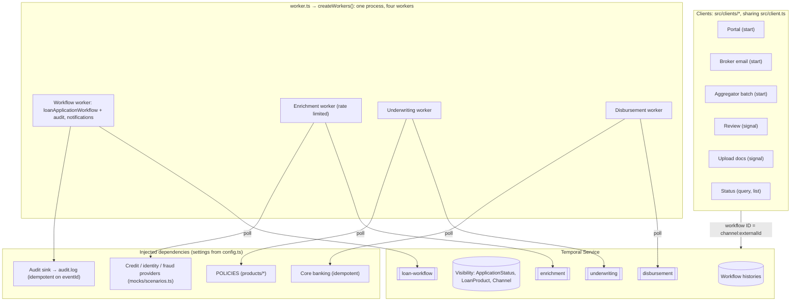
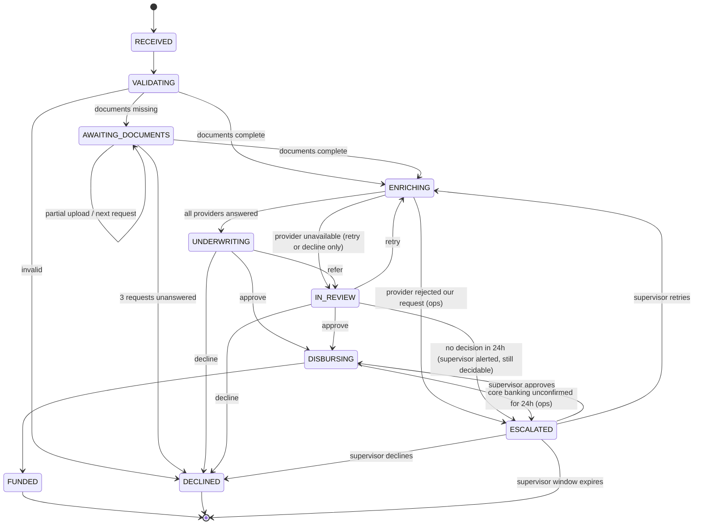
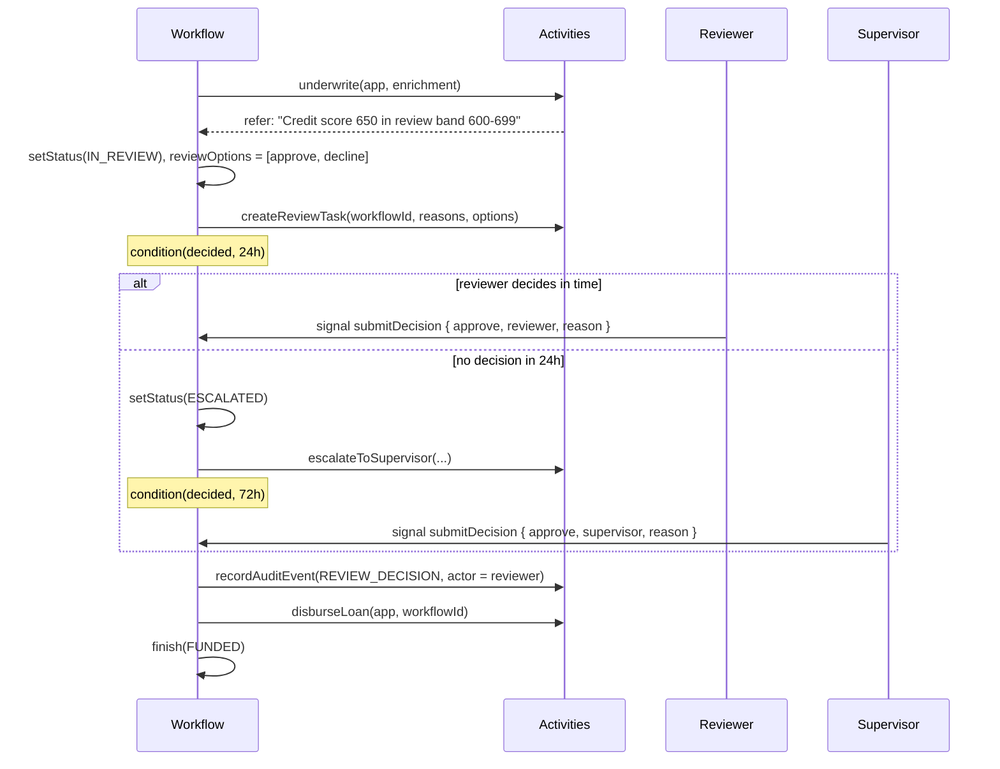

# Loan disbursement on Temporal

A mid-sized bank takes personal loan applications from three channels (a self-serve portal, broker
emails and aggregator batch feeds) and today takes about four days to get each one to a decision.
This repo models the whole lifecycle as one Temporal workflow per application: ingest, validate,
collect documents, enrich with credit, identity and fraud checks, underwrite per product, pause for
human review when needed, and disburse. Every application ends in exactly one terminal state
(`FUNDED`, `DECLINED` or `ESCALATED`), every decision is audited with the inputs it was based on,
and operators can see where any application stands at any time.

Everything runs locally against the Temporal dev server. Third-party providers, core banking and
the audit store are deterministic mocks behind the same interfaces real clients would implement.

- [Quick start](#quick-start) · [Demo](#demo)
- [Assumptions](#assumptions)
- [Architecture](#architecture) · [Application lifecycle](#application-lifecycle)
- [Workflow design](#workflow-design) · [Activity design](#activity-design) · [Human in the loop](#human-in-the-loop)
- [Ingestion](#ingestion) · [Failure handling](#failure-handling) · [Product isolation](#product-isolation)
- [Observability and audit](#observability-and-audit) · [Testing](#testing)
- [Trade-offs](#trade-offs) · [Production concerns](#production-concerns) · [Deploying to AWS](#deploying-to-aws)
- [What I'd do next](#what-id-do-next)
- [Repo layout](#repo-layout)

## Quick start

Requires Node 20+ and the [Temporal CLI](https://docs.temporal.io/cli) (`brew install temporal`).

```bash
temporal server start-dev        # terminal 1 (Web UI: http://localhost:8233)

npm install
./scripts/setup.sh               # registers the custom search attributes (once per server)
npm run worker                   # terminal 2: all four workers in one process

./scripts/demo.sh                # terminal 3: guided walkthrough, one scenario per step
npm test                         # 59 tests: policies, money, activities, and workflows on a local dev server
```

## Demo

`scripts/demo.sh` walks through every path. The sample inputs live in `samples/`, and the expected
outcome for each applicant is declared in `src/mocks/scenarios.ts` (the tests check both agree).

| Sample | Applicant | Product | Path |
|---|---|---|---|
| `portal-form.json` | Jane | personal | approve → `FUNDED` |
| `broker-email.txt` | Sam | auto | missing bill of sale → `AWAITING_DOCUMENTS` → upload → `FUNDED` |
| `broker-email.txt` (again) | Sam | auto | rejected as a duplicate |
| `aggregator-batch.json` rec-001 | Alex | debt consolidation | approve → `FUNDED` |
| `aggregator-batch.json` rec-002 | Priya | personal | borderline credit → `IN_REVIEW` → approved → `FUNDED` |
| `aggregator-batch.json` rec-003 | Chris | auto | poor credit → `DECLINED` |
| `aggregator-batch.json` rec-004 | Morgan | debt consolidation | good credit, over product cap → `DECLINED` |
| `aggregator-batch.json` rec-005 | Taylor | personal | good credit, high fraud risk → `IN_REVIEW` → declined |

Failure demos, by restarting the worker with a flag:

```bash
FRAUD_OUTAGE=1 npm run worker                          # fraud returns 503: enrichment retries with backoff
IDENTITY_NOT_FOUND=jane.doe@example.com npm run worker # identity 404: an answer, so Jane is declined
```

Useful while it runs:

```bash
npm run status -- portal:app-123                                 # one application's full state
npm run status -- --query 'ApplicationStatus="IN_REVIEW"'        # everything waiting on a reviewer
npm run review -- <workflowId> <approve|decline|retry> <reviewer> "<reason>"
npm run upload-docs -- <workflowId> <documentType>               # applicant uploads a document
```

The review client reads the application's `reviewOptions` first and refuses a decision the
workflow wouldn't accept (for example `approve` while a provider's result is missing).

## Assumptions

- **Review can escalate, and escalation can still be decided.** The brief lists `escalated` as a
  terminal state and also asks for review that resumes. If no reviewer decides within 24 hours, the
  application is escalated to a supervisor (status `ESCALATED`, supervisor alerted) and a decision
  is still accepted. Only when the supervisor window also expires does the workflow complete as
  `ESCALATED`, with ops alerted. Applications that need manual handling for other reasons (a
  provider rejecting our request, disbursement not confirmed) also complete as `ESCALATED`.
- **Funded means core banking confirmed the disbursement.** Reconciling failed or returned payouts
  after that point is out of scope.
- **Abandoned applications are declined.** Missing documents are requested three times, 24 hours
  apart. If all three go unanswered the application is declined, 72 hours after the first request.
- **The 48-hour target is measured on time the bank controls.** The clock pauses while waiting on
  the applicant for documents. Providers get up to 12 hours of retries and review gets 24 hours, so
  a referred application can still be decided inside 48 hours. Escalation means the target was
  missed and a supervisor owns it.
- **Money is integer cents.** Dollar strings are parsed once at the channel adapters
  (`shared/money.ts`); no floating point ever touches an amount.
- **External systems are mocked.** Credit, identity and fraud providers, core banking,
  notifications and the audit store are in-memory or file-based mocks behind real interfaces.

## Architecture



- **Clients** turn each channel's input into one `LoanApplication` and start a workflow, or send
  signals and queries to an existing one. A client is just code that uses a Temporal `Client`.
- **The Temporal Service** stores each workflow's event history (the durable state), holds the task
  queues, and indexes search attributes for operator queries.
- **Workers** poll one task queue each. The workflow worker runs the deterministic orchestration
  code; the others run activities, the code that talks to the outside world.
- **Dependencies are injected.** Activity files export factories (`createEnrichmentActivities(deps)`)
  rather than bare functions, and `createWorkers(connection, deps)` builds all four workers from
  them. `worker.ts` passes the mocks; the tests use the same function with stubs. Going to
  production means replacing the bottom row with real clients, and nothing above it changes.

## Application lifecycle



`ESCALATED` while the workflow is running means "a supervisor needs to decide this now"; a
completed workflow in `ESCALATED` means it has been handed to ops. Any unexpected failure (an
activity out of retries, a bug) also completes as `ESCALATED` rather than leaving a Failed workflow.

## Workflow design

`src/workflows.ts` defines `loanApplicationWorkflow(app, timing?)`, one execution per application.

- **One workflow per application, ID `channel:externalId`.** One ID gives an operator the entire
  history, and Temporal rejects duplicate starts (`REJECT_DUPLICATE`), which is the dedup strategy.
- **The workflow only decides; activities do.** Workflow code is deterministic and replayed by
  Temporal, so it never does I/O. Every external call is an activity, recorded once in history.
- **State lives in the workflow.** An `ApplicationState` object (status, history, documents,
  enrichment, underwriting decision, review reasons and options, disbursement reference, outcome
  reason) is exposed by the `getStatus` query. There's no separate status table to keep in sync.
- **`setStatus()` mirrors every transition** into the `ApplicationStatus` search attribute, so
  visibility queries always match what the workflow is doing.
- **`finish()` is the only way out.** It sets the terminal status, records why, writes the audit
  event, and notifies the applicant (funded or declined) or alerts ops (escalated). The lifecycle
  runs inside a catch-all that turns any unexpected failure into `finish('ESCALATED', ...)`. Only a
  deliberate operator cancellation is let through, so Temporal records it as Cancelled.
- **Timing is a workflow argument** (`reviewTimeout`, `escalationTimeout`,
  `documentReminderInterval`, `maxDocumentRequests`, `providerRetryWindow`) with production
  defaults. Workflow code can't read config, so this is how timing stays configurable; tests pass
  short values.
- **Approval is an audit event, not a status.** It's instantaneous before disbursement, so a status
  for it would never be visible in a query.

## Activity design

| Activity | Task queue | Timeouts and retries | Notes |
|---|---|---|---|
| `pullCredit`, `verifyIdentity`, `checkFraud` | `enrichment` | 30s per attempt; backoff 1s → 5m; give up after `providerRetryWindow` (12h) | Called in parallel. Queue is rate limited (`ENRICHMENT_RPS`, default 10/s). |
| `missingDocuments`, `underwrite` | `underwriting` | 30s; max 5 attempts | Pure policy evaluation, so repeated failure means a bug, not an outage. |
| `disburseLoan` | `disbursement` | 1m; backoff 5s → 10m; give up after 24h | Idempotent: the workflow ID is the idempotency key, so retries never pay twice. |
| `recordAuditEvent` | `loan-workflow` | 10s; retried until it succeeds | Idempotent on `eventId` (`workflowId:sequence`), so a retried write isn't duplicated. |
| `requestDocuments`, `createReviewTask`, `escalateToSupervisor`, `alertOperations`, `notifyApplicant` | `loan-workflow` | 10s; retried until they succeed | Notifications to applicants, reviewers, supervisors and ops. |

Each activity file exports a factory that takes its dependencies, following Temporal's
[dependency injection pattern](https://docs.temporal.io/develop/typescript/activities/basics):
`createEnrichmentActivities({ credit, identity, fraud })`, `createUnderwritingActivities(POLICIES)`,
`createDisbursementActivities(coreBanking)`, and so on. The workflow imports only their types
(`proxyActivities<ReturnType<typeof createEnrichmentActivities>>`), so no runtime code enters the
workflow sandbox.

**Why underwriting is an activity, not inline workflow code:** policies are pure functions and could
run in the workflow, but then a rule change would alter replay for in-flight applications and break
determinism. As an activity, each decision is recorded once in history, so policies can change
without workflow versioning. Structural validation (known product, positive integer amount) does
stay inline: it checks the input's shape, not business rules, and changes about as often as the
workflow itself.

## Human in the loop



- **When a human enters:** the policy refers (borderline credit, or high fraud risk with good
  credit), or a provider is still unavailable after its retry window.
- **What they can decide depends on why they're there.** A referral offers `approve` or
  `decline`. Incomplete provider data offers only `retry` (re-run just the providers that failed)
  or `decline`. There is no way to fund a loan without the full set of checks. The current options
  are exposed as `reviewOptions` in the status query; the workflow ignores and logs anything else.
- **How the workflow waits:** `condition()` with a timeout. The wait is durable: workers can restart
  and the server can go down, and the workflow still resumes exactly where it stopped.
- **How it resumes:** the decision arrives as the `submitDecision` signal. Approve continues to
  disbursement, retry goes back to enrichment, decline finishes as `DECLINED`.
- **Escalation is not a dead end.** After 24 hours without a decision a supervisor is alerted and
  the status becomes `ESCALATED`, but the application stays decidable for another 72 hours. Only
  then does it complete as `ESCALATED` and alert ops.
- **Documents use the same pattern.** The workflow waits in `AWAITING_DOCUMENTS` for the
  `documentsUploaded` signal, re-checks what's still missing after each upload (one upload may not
  cover everything), and sends a new request each interval.

## Ingestion

Each channel is an adapter in `src/clients/` that maps its own format to `LoanApplication` and
calls the shared `startApplication()`:

- **Portal** (`portal.ts`): JSON form; the amount string is parsed to cents. In production, an API route.
- **Broker email** (`broker.ts`): parses a known email template. The email's `Message-ID` is the
  external ID, so a re-sent email is rejected as a duplicate. Production would use LLM extraction
  with schema validation, sending low-confidence parses to review.
- **Aggregator batch** (`aggregator.ts`): one workflow per record. A bad record is logged and
  skipped without blocking the rest of the batch. Unknown products are declined by the workflow's
  validation.

Because the workflow ID is `channel:externalId` with `REJECT_DUPLICATE`, Temporal itself is the
dedup layer: no lookup table, no race between check and insert. Adding a fourth channel means
writing one `fromX()` mapping function.

## Failure handling

| Failure | Handling |
|---|---|
| Rate limit (429) or outage (5xx, timeout) | `providerErrors.ts` rethrows, so the activity's retry policy backs off (up to 5 minutes between attempts) |
| Provider still unavailable after 12h | `Promise.allSettled` keeps the other providers' results; a reviewer chooses retry (only the failed provider is called again) or decline. Never approve |
| Provider rejects our request (other 4xx) | Non-retryable `<Provider>Rejected`: our request is wrong, which is a bug for ops, not an underwriting question. Escalated straight to ops |
| Identity "not found" (404) | Non-retryable `IdentityNotFound`, treated as an answer (`verified: false`) and declined by the policy |
| Partial failure mid-workflow | Completed activities are recorded in history and never re-run on retry or replay. Only the failing call retries |
| Worker crash | Another worker replays the history and continues from the last completed step |
| Disbursement retried | Idempotent on the workflow ID; never pays twice |
| Audit write retried after succeeding | Idempotent on `eventId`; recorded once |
| Core banking unconfirmed for 24h | `ESCALATED` to ops for reconciliation |
| Anything unexpected (bug, activity out of retries) | Caught at the top of the workflow and finished as `ESCALATED`, never left as a Failed workflow |
| Operator cancels the workflow | Rethrown deliberately (never caught by the handlers above), so Temporal records it as Cancelled |

## Product isolation

Each product is one file in `src/products/` implementing `ProductPolicy`: its required documents,
its amount cap, its credit bands, and a `version` the underwriting activity stamps on every
decision. Policies are injected into the underwriting activities as a registry (`POLICIES`), so the
underwriting code knows nothing about specific products.

| | Personal | Auto | Debt consolidation |
|---|---|---|---|
| Required documents | id, pay stub | + vehicle bill of sale | + debt statements |
| Max amount | $50,000 | $75,000 | $50,000 |
| Approve | score ≥ 700 | score ≥ 680 (secured by the vehicle) | score ≥ 700 |
| Refer | 600–699 | 600–679 | 620–699 |
| Every product | identity not verified → decline · over cap → decline · fraud high → refer | | |

The hard stops repeat in each policy file on purpose: each product owns its whole rule set and can
diverge (a lender might accept medium fraud risk on a secured auto loan) without touching the
others. Adding a product means adding one policy file and one registry entry. Thresholds are
versioned code, not configuration, so every decision in the audit log maps to an exact rule set.

## Observability and audit

- **Where does every application stand?** The workflow keeps the `ApplicationStatus`, `LoanProduct`
  and `Channel` search attributes current:

  ```bash
  npm run status -- --query 'ApplicationStatus="IN_REVIEW"'                                  # reviewer queue
  npm run status -- --query 'ApplicationStatus="ESCALATED" AND ExecutionStatus="Running"'    # supervisor queue
  npm run status -- --query 'ApplicationStatus="ESCALATED" AND ExecutionStatus="Completed"'  # handed to ops
  npm run status -- --query 'ApplicationStatus="AWAITING_DOCUMENTS" AND LoanProduct="auto"'
  npm run status -- --query 'ExecutionStatus="Running" AND StartTime < "2026-11-20T00:00:00Z"'   # at risk of missing 48h
  ```

- **What happened to one application?** `npm run status -- <workflowId>` returns its full state,
  including the status history with timestamps and, while waiting, why it's waiting and which
  decisions are accepted. The Web UI shows every activity, retry, timer and signal.
- **Is something broken?** Failing activities show their retry attempts and last error in the Web
  UI. A provider outage shows up as many workflows stuck in `ENRICHING` and then in review with
  `unavailableProviders` set. Escalations alert ops through `alertOperations`. In production I'd
  alert on activity failure rate and schedule-to-start latency per task queue.
- **Audit.** Every automated and human decision is written to an append-only log (`audit.log`, JSON
  lines) with an idempotency key (`eventId`), the actor (`system` or the reviewer), and the policy
  version. Underwriting decisions record their inputs (product, amount, credit score, identity
  result, fraud level), not just the reasons, so a decision can be explained later. The log is
  separate from Temporal history on purpose: history has a retention period, and a regulator needs a
  permanent record.

## Testing

```bash
npm test     # 59 tests, ~25s
```

- **Policies** (`policies.test.ts`): table-driven tests on every band boundary, amount cap and
  fraud/identity rule, plus a check that each demo sample, run through the real channel mappers, has
  its required documents and reaches its expected outcome.
- **Activities and money** (`activities.test.ts`): disbursement idempotency, audit idempotency,
  policy selection per product, missing documents, unknown products failing non-retryably, and
  dollar parsing and formatting without floats.
- **Workflows** (`workflows.test.ts`): every path end to end on a real dev server: funded, declined,
  over the cap, unknown product, review approve and decline, escalation with a late supervisor
  decision, escalation expiring, documents uploaded, documents abandoned, a decision sent when
  nothing is pending, and a **replay test** (`Worker.runReplayHistory`) that checks the workflow is
  deterministic against a recorded history.
- **Failures** (`workflows-mocks.test.ts`): a provider outage goes to review where approve is
  refused and retry re-runs only the failed provider; a provider rejecting our request goes to ops;
  an identity 404 declines immediately; and a policy that throws ends `ESCALATED`, not Failed.

Workflow tests run on the Temporal dev server (`createLocal`) rather than the time-skipping test
server, because only the dev server can register custom search attributes. They run in real time, so
timeout paths pass short timing overrides.

## Trade-offs

**One workflow per application.** The state machine reads top to bottom and one ID gives the full
history. At 50k applications a month histories stay small, so I didn't need child workflows or
continue-as-new. If a stage grew complex (multi-step document collection, say), I'd split it into a
child workflow.

**Dedup via workflow ID, not a database.** Simple and race-free, but only as good as each channel's
external ID: a broker re-sending the same applicant in a new email gets a new workflow. Production
would add content-based matching (applicant, product, amount) at ingestion.

**Aggregator ingestion is a client loop.** A crash mid-file restarts the batch. Duplicates are
rejected, so it's safe, just wasteful. At scale I'd move it into a `BatchIngestWorkflow` that tracks
file position durably.

**One rate limit for all enrichment providers.** Credit, identity and fraud share the `enrichment`
queue and one limit. Real providers have different limits, so production would use one queue per
provider.

**Underwriting runs as an activity.** Keeps policy changes replay-safe without workflow versioning,
at the cost of one extra round trip per application.

**Policies are versioned code, not configuration.** Favours auditability over letting the business
change rules without a deploy. A rules engine would be the next step, but it would need the same
versioning guarantee.

**A provider outage asks a human rather than waiting forever.** After 12 hours of retries the
workflow asks a reviewer to retry or decline. That keeps applications inside the 48-hour target and
always heading for a terminal state, at the cost of reviewer time during long outages.

**Escalation keeps the workflow open.** A supervisor can still decide for 72 hours after the review
window, so an escalated application isn't lost revenue by default. The cost is longer-running
workflows, which makes workflow versioning matter (see below).

**Audit log separate from Temporal history.** Audit writes are activities retried until they
succeed: if the sink is down, the workflow waits rather than making an unrecorded decision.

**Signals for human input, not Updates.** Simple and durable, but a signal can't be rejected, so
the workflow ignores invalid decisions and the review client checks `reviewOptions` before sending.
A workflow Update with a validator would reject them at the source and return a result.

**Deterministic mocks.** Provider results come from a scenario table and failures are switched on by
flags, not random rates, so the demo is repeatable. The core banking and audit mocks keep their
idempotency keys in memory; real systems persist them.

**All workers in one process.** Keeps the demo to one command. In production each worker would
deploy and scale separately, with disbursement the most locked down.

**Tests on the dev server, not time skipping.** Needed for custom search attributes, at the cost of
real-time tests; timing overrides keep the suite at about 25 seconds.

## Production concerns

Things I deliberately left out of the exercise but would expect to be asked about:

- **Deploying workflow changes.** Workflows run for days (document waits, review, escalation), so
  any change to `workflows.ts` must not break replay for in-flight runs. Small changes go behind
  `patched()` / `deprecatePatch()`; larger ones use worker versioning, so new runs pick up new code
  while existing runs drain on the old build. The replay test is the guard: in CI it should run
  against histories recorded from the previous release, not just fresh ones.
- **Personal data in history.** Applicant names and emails are in workflow inputs and history, and
  broker message IDs are in workflow IDs. Production would encrypt payloads with a payload codec
  (and a codec server for the Web UI), and use opaque IDs rather than anything containing personal
  data.
- **Reviewer identity.** The reviewer is a free-text argument today. In production the review and
  upload signals sit behind an authenticated API that sets the reviewer from the session, and the
  audit log records that identity.
- **Product isolation beyond underwriting.** Every product shares one workflow and the same three
  providers. A product that needs its own check (a vehicle valuation for auto loan-to-value) would
  mean editing the shared workflow. The next step is for each policy to declare its enrichment plan,
  or for product-specific steps to run as child workflows.
- **What breaks first at 50k a month.** Not Temporal: reviewer capacity and per-provider rate
  limits. Both are visible today through the `IN_REVIEW` queue size and enrichment retry counts.

## Deploying to AWS

A proposed plan, not something built or tested in this repo. The code is mostly shaped for it
already: workers are built by one function (`createWorkers()`), all settings come from `config.ts`,
and mocks are swapped for real clients in one file (`worker.ts`).

**1. Temporal.** Use Temporal Cloud rather than self-hosting: no database, visibility store or
upgrades to run. Create a namespace per environment, connect over AWS PrivateLink, and
authenticate workers with an API key or mTLS certificates kept in AWS Secrets Manager. Register the
three search attributes as part of environment setup (the cloud equivalent of `scripts/setup.sh`).
Self-hosting is possible on EKS with the Temporal Helm chart, Aurora PostgreSQL and OpenSearch, but
it's a platform to operate in its own right.

**2. Workers.** Build one container image and push it to ECR. Run it as four ECS Fargate services,
one per task queue. Today `worker.ts` starts all four workers in one process, so the one code change
is a `WORKER_QUEUE` environment variable that picks which one this service runs:

| Service | Scales on | Network and IAM |
|---|---|---|
| Workflow worker | Workflow task backlog | Temporal, the audit store and notifications (SES, SNS) |
| Enrichment worker | Activity backlog; capped by the provider rate limit | Egress to credit, identity and fraud providers |
| Underwriting worker | Activity backlog | Temporal only; no external access |
| Disbursement worker | Fixed small count | The only service allowed to reach core banking |

Autoscale on task queue backlog or schedule-to-start latency, both exported by the Temporal SDK as
metrics. All services run in private subnets; only the enrichment and disbursement workers get
outbound routes beyond Temporal.

*Alternative: Lambda.* Temporal's Serverless Workers (`@temporalio/lambda-worker`) let Temporal
Cloud invoke a worker on AWS Lambda only when tasks arrive, with no long-running process. Long
waits (review, documents) cost nothing, because a waiting workflow isn't running. Enrichment and
underwriting, which are short and bursty, are a good fit, and the workflow worker would work too.
I'd keep disbursement on a small always-on ECS service, since core banking connections usually
need stable networking and IP allowlisting. Serverless Workers are still pre-release for
TypeScript, so I'd start on ECS and move the bursty workers once the feature is generally available.

**3. Configuration and secrets.** Environment variables per service map onto `config.ts`; provider
credentials, the Temporal API key and core banking credentials come from Secrets Manager, scoped
per service by IAM task role.

**4. Real dependencies behind the existing interfaces.**
- Audit store: DynamoDB with a conditional write on `eventId` (idempotent), streamed to S3 with
  Object Lock for an immutable long-term record.
- Notifications: SES for applicants, SNS or Slack for the review, supervisor and ops queues.
- Providers and core banking: HTTP clients implementing `CreditBureau`, `IdentityProvider`,
  `FraudProvider` and `CoreBanking`, injected in `worker.ts`.

**5. Ingestion channels.**
- Portal: an API on API Gateway and Lambda (or ECS) calling `startApplication()`.
- Broker email: SES inbound to S3, a Lambda parses it and starts the workflow.
- Aggregator batches: files land in S3, an event starts a `BatchIngestWorkflow` per file.
- Review console: an internal app behind Cognito, sending the reviewer's identity with each
  decision.

**6. Data protection.** Encrypt workflow payloads with a payload codec backed by AWS KMS, and run a
codec server so the Temporal Web UI can still show decrypted data to authorised staff.

**7. Shipping changes.** CI builds the image, runs the tests, and runs the replay test against
histories recorded from the previous release. Deploy with Temporal worker versioning so in-flight
workflows finish on the build they started on, and roll out in order: activity workers first, then
the workflow worker, then the clients that start new workflows.

**8. Monitoring.** Export SDK metrics to CloudWatch (or Prometheus and Grafana), and alarm on
activity failure rate per queue, schedule-to-start latency, the size of the review and supervisor
queues, and applications approaching the 48-hour target.

## What I'd do next

- One task queue and rate limit per provider, and honour `Retry-After` on 429s.
- Workflow Updates with validators for review decisions and document uploads.
- A `BatchIngestWorkflow` for aggregator files, and content-based duplicate detection across channels.
- An `SlaDeadline` search attribute (paused while waiting on the applicant) and alerts on
  applications at risk of missing 48 hours.
- Loan-to-value checks for auto and post-consolidation DTI for debt consolidation, as new policy
  versions with their own enrichment.
- A reviewer UI on top of the existing signals and queries.
- A Dockerfile and Docker Compose with one service per worker, as the first step towards the AWS plan above.

## Repo layout

```
src/
  workflows.ts            the lifecycle state machine
  workers.ts              createWorkers(): the four workers from their dependencies
  worker.ts               production entry point: wires mocks into createWorkers()
  config.ts               the only file that reads process.env
  client.ts               shared: connect, startApplication (dedup by workflow ID)
  activities/             factories: enrichment, underwriting, disbursement, audit, notifications
  products/               one ProductPolicy per product, plus the POLICIES registry
  clients/                portal, broker, aggregator, review, upload-docs, status
  mocks/                  deterministic providers and the demo scenario table
  shared/                 domain types, money, signals and queries, task queues, search attributes
  mocha/                  tests and the shared test harness
samples/                  demo inputs (see samples/README.md)
scripts/                  setup.sh (search attributes), demo.sh (guided walkthrough)
docs/PLAN.md              how I approached the exercise
```
