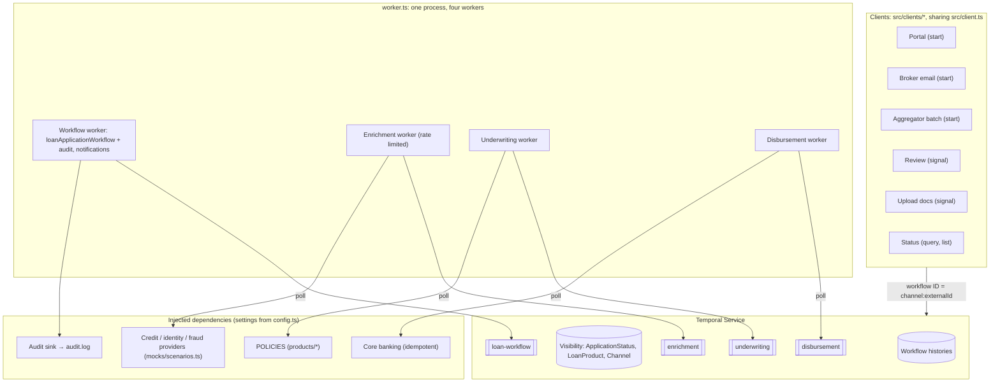
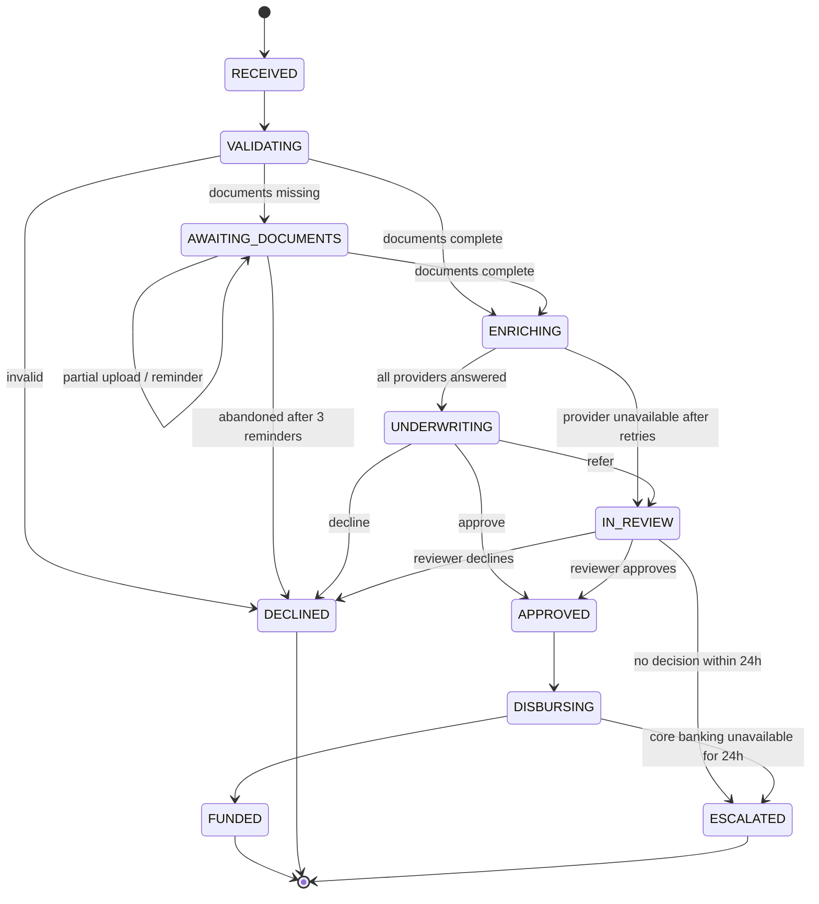
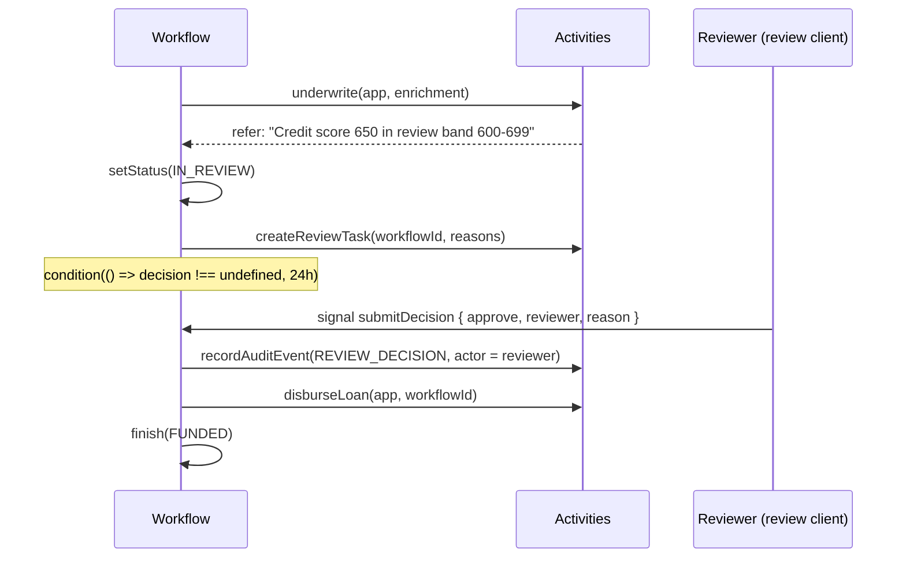

# Loan disbursement on Temporal

A mid-sized bank takes personal loan applications from three channels (a self-serve portal, broker
emails and aggregator batch feeds) and today takes about four days to get each one to a decision.
This repo models the whole lifecycle as one Temporal workflow per application: ingest, validate,
collect documents, enrich with credit, identity and fraud checks, underwrite per product, pause for
human review when needed, and disburse. Every application ends in exactly one terminal state
(`FUNDED`, `DECLINED` or `ESCALATED`), every decision is audited, and operators can see where any
application stands at any time.

Everything runs locally against the Temporal dev server. Third-party providers, core banking and
the audit store are deterministic mocks behind the same interfaces real clients would implement.

- [Quick start](#quick-start) · [Demo](#demo)
- [Assumptions](#assumptions)
- [Architecture](#architecture) · [Application lifecycle](#application-lifecycle)
- [Workflow design](#workflow-design) · [Activity design](#activity-design) · [Human in the loop](#human-in-the-loop)
- [Ingestion](#ingestion) · [Failure handling](#failure-handling) · [Product isolation](#product-isolation)
- [Observability and audit](#observability-and-audit) · [Testing](#testing)
- [Trade-offs](#trade-offs) · [What I'd do next](#what-id-do-next) · [Repo layout](#repo-layout)

## Quick start

Requires Node 20+ and the [Temporal CLI](https://docs.temporal.io/cli) (`brew install temporal`).

```bash
temporal server start-dev        # terminal 1 (Web UI: http://localhost:8233)

npm install
./scripts/setup.sh               # registers the custom search attributes (once per server)
npm run worker                   # terminal 2: all four workers in one process

./scripts/demo.sh                # terminal 3: guided walkthrough, one scenario per step
npm test                         # 50 tests: policies, activities, and workflows on a local dev server
```

## Demo

`scripts/demo.sh` walks through every path. The sample inputs live in `samples/`, and the expected
outcome for each applicant is declared in `src/mocks/scenarios.ts` (the tests check both agree).

| Sample | Applicant | Product | Path |
|---|---|---|---|
| `portal-form.json` | Jane | personal | approve → `FUNDED` |
| `broker-email.txt` | Sam | auto | missing bill of sale → `AWAITING_DOCUMENTS` → upload → `FUNDED` |
| `broker-email.txt` (again) | Sam | auto | rejected as a duplicate |
| `aggregator-batch.json` rec-001 | Alex | debt consolidation | approve → `FUNDED` |
| `aggregator-batch.json` rec-002 | Priya | personal | borderline credit → `IN_REVIEW` → approved → `FUNDED` |
| `aggregator-batch.json` rec-003 | Chris | auto | poor credit → `DECLINED` |
| `aggregator-batch.json` rec-004 | Morgan | debt consolidation | good credit, over product cap → `DECLINED` |
| `aggregator-batch.json` rec-005 | Taylor | personal | good credit, high fraud risk → `IN_REVIEW` → declined |

Failure demos, by restarting the worker with a flag:

```bash
FRAUD_OUTAGE=1 npm run worker                         # fraud returns 503: enrichment retries with backoff
IDENTITY_NOT_FOUND=jane.doe@example.com npm run worker # identity 404: non-retryable, declined immediately
```

Useful while it runs:

```bash
npm run status -- portal:app-123                               # one application's full state
npm run status -- --query 'ApplicationStatus="IN_REVIEW"'      # everything waiting on a human
npm run review -- <workflowId> approve <reviewer> "<reason>"   # human decision
npm run upload-docs -- <workflowId> <documentType>             # applicant uploads a document
```

## Assumptions

- **Escalated is terminal; review is a pause.** The brief lists `escalated` as a terminal state and
  also asks for review that resumes. I treat `IN_REVIEW` as a paused state that resumes when a
  reviewer decides, and `ESCALATED` as the terminal hand-off when nothing is decided in time (or
  when an approved loan can't be disbursed and needs manual reconciliation).
- **Funded means core banking confirmed the disbursement.** Reconciling failed or returned payouts
  after that point is out of scope.
- **Abandoned applications are declined.** An applicant who never supplies required documents is
  declined after three reminders, with the reason recorded.
- **The 48-hour target shapes the timeouts.** Providers get up to 12 hours of retries, review gets
  24 hours, so a referred application can still be decided inside 48 hours.
- **External systems are mocked.** Credit, identity and fraud providers, core banking, notifications
  and the audit store are in-memory or file-based mocks behind real interfaces.

## Architecture



- **Clients** turn each channel's input into one `LoanApplication` and start a workflow, or send
  signals and queries to an existing one. A client is just code that uses a Temporal `Client`.
- **The Temporal Service** stores each workflow's event history (the durable state), holds the task
  queues, and indexes search attributes for operator queries.
- **Workers** poll one task queue each. The workflow worker runs the deterministic orchestration
  code; the others run activities, the code that talks to the outside world.
- **Dependencies are injected** in `worker.ts`. Activity files export factories
  (`createEnrichmentActivities(deps)`) rather than bare functions, so going to production means
  replacing the bottom row with real clients, and nothing above it changes.

## Application lifecycle



## Workflow design

`src/workflows.ts` defines `loanApplicationWorkflow(app, timing?)`, one execution per application.

- **One workflow per application, ID `channel:externalId`.** One ID gives an operator the entire
  history, and Temporal rejects duplicate starts (`REJECT_DUPLICATE`), which is the dedup strategy.
- **The workflow only decides; activities do.** Workflow code is deterministic and replayed by
  Temporal, so it never does I/O. Every external call is an activity, recorded once in history.
- **State lives in the workflow.** An `ApplicationState` object (status, history, missing documents,
  enrichment, underwriting decision, review, disbursement reference, outcome reason) is exposed by
  the `getStatus` query. There's no separate status table to keep in sync.
- **`setStatus()` mirrors every transition** into the `ApplicationStatus` search attribute, so
  visibility queries always match what the workflow is doing.
- **`finish()` is the only way out.** It sets the terminal status, records why, writes the audit
  event and notifies the applicant, which is how every path is guaranteed to end in a terminal state.
- **Timing is a workflow argument** (`reviewTimeout`, `documentReminderInterval`,
  `maxDocumentReminders`) with production defaults. Workflow code can't read config, so this is how
  timing stays configurable; tests pass short values.

## Activity design

| Activity | Task queue | Timeouts and retries | Notes |
|---|---|---|---|
| `pullCredit`, `verifyIdentity`, `checkFraud` | `enrichment` | 30s per attempt; backoff 1s → 5m; give up after 12h | Called in parallel. Queue is rate limited (`ENRICHMENT_RPS`, default 10/s). |
| `missingDocuments`, `underwrite` | `underwriting` | 30s; max 5 attempts | Pure policy evaluation, so repeated failure means a bug, not an outage. |
| `disburseLoan` | `disbursement` | 1m; backoff 5s → 10m; give up after 24h | Idempotent: the workflow ID is the idempotency key, so retries never pay twice. |
| `recordAuditEvent`, `requestDocuments`, `createReviewTask`, `notifyApplicant` | `loan-workflow` | 10s; retried until they succeed | No decision goes unrecorded. |

Each activity file exports a factory that takes its dependencies, following Temporal's
[dependency injection pattern](https://docs.temporal.io/develop/typescript/activities/basics):
`createEnrichmentActivities({ credit, identity, fraud })`, `createUnderwritingActivities(POLICIES)`,
`createDisbursementActivities(coreBanking)`, and so on. The workflow imports only their types
(`proxyActivities<ReturnType<typeof createEnrichmentActivities>>`), so no runtime code enters the
workflow sandbox.

**Why underwriting is an activity, not inline workflow code:** policies are pure functions and could
run in the workflow, but then a rule change would alter replay for in-flight applications and break
determinism. As an activity, each decision is recorded once in history, so policies can change
without workflow versioning.

## Human in the loop



- **When a human enters:** the policy refers (borderline credit, or high fraud risk with good
  credit), or a provider is still unavailable after its retry window, so there isn't enough data to
  decide automatically.
- **How the workflow waits:** `condition()` with a timeout. The wait is durable: workers can restart
  and the server can go down, and the workflow still resumes exactly where it stopped.
- **How it resumes:** the reviewer's decision arrives as the `submitDecision` signal. Approve
  continues to disbursement, decline finishes as `DECLINED`, and no decision within 24 hours
  finishes as `ESCALATED`. Decisions that arrive when the application isn't in review are ignored
  and logged.
- **Documents use the same pattern.** The workflow waits in `AWAITING_DOCUMENTS` for the
  `documentsUploaded` signal, re-checks what's still missing after each upload (one upload may not
  cover everything), sends a reminder each interval, and declines as abandoned after three.

## Ingestion

Each channel is an adapter in `src/clients/` that maps its own format to `LoanApplication` and
calls the shared `startApplication()`:

- **Portal** (`portal.ts`): JSON form. In production, an API route.
- **Broker email** (`broker.ts`): parses a known email template. The email's `Message-ID` is the
  external ID, so a re-sent email is rejected as a duplicate. Production would use LLM extraction
  with schema validation, sending low-confidence parses to review.
- **Aggregator batch** (`aggregator.ts`): one workflow per record. A bad record is logged and
  skipped without blocking the rest of the batch.

Because the workflow ID is `channel:externalId` with `REJECT_DUPLICATE`, Temporal itself is the
dedup layer: no lookup table, no race between check and insert. Adding a fourth channel means
writing one `fromX()` mapping function.

## Failure handling

| Failure | Handling |
|---|---|
| Rate limit (429) or outage (5xx, timeout) | `providerErrors.ts` rethrows, so the activity's retry policy backs off (up to 5 minutes between attempts) |
| Permanent rejection (4xx) | Converted to a non-retryable `ApplicationFailure`, so the workflow acts on it immediately |
| Identity "not found" (404) | Treated as an answer, `{ verified: false }`, and declined by the policy |
| Provider still down after 12h | `Promise.allSettled` keeps the other providers' results; the application goes to review with the unavailable provider recorded |
| Partial failure mid-workflow | Completed activities are recorded in history and never re-run on retry or replay. Only the failing call retries |
| Worker crash | Another worker replays the history and continues from the last completed step |
| Disbursement retried | Idempotent on the workflow ID; never pays twice |
| Core banking down for 24h | `ESCALATED` for manual reconciliation |

## Product isolation

Each product is one file in `src/products/` implementing `ProductPolicy`: its required documents,
its amount cap, its credit bands, and a `version` stamped on every decision. Policies are injected
into the underwriting activities as a registry (`POLICIES`), so the underwriting code knows nothing
about specific products.

| | Personal | Auto | Debt consolidation |
|---|---|---|---|
| Required documents | id, pay stub | + vehicle bill of sale | + debt statements |
| Max amount | $50,000 | $75,000 | $50,000 |
| Approve | score ≥ 700 | score ≥ 680 (secured by the vehicle) | score ≥ 700 |
| Refer | 600–699 | 600–679 | 620–699 |
| Every product | identity not verified → decline · over cap → decline · fraud high → refer | | |

Adding a product means adding one policy file and one registry entry. Thresholds are versioned code,
not configuration, so every decision in the audit log maps to an exact rule set.

## Observability and audit

- **Where does every application stand?** The workflow keeps the `ApplicationStatus`, `LoanProduct`
  and `Channel` search attributes current:

  ```bash
  npm run status -- --query 'ApplicationStatus="IN_REVIEW"'
  npm run status -- --query 'ApplicationStatus="AWAITING_DOCUMENTS" AND LoanProduct="auto"'
  npm run status -- --query 'ExecutionStatus="Running" AND StartTime < "2026-11-20T00:00:00Z"'   # at risk of missing 48h
  ```

- **What happened to one application?** `npm run status -- <workflowId>` returns its full state,
  including the status history with timestamps. The Web UI shows every activity, retry, timer and
  signal.
- **Is something broken?** Failing activities show their retry attempts and last error in the Web
  UI. A provider outage shows up as many workflows stuck in `ENRICHING`, and in production I'd alert
  on activity failure rate and schedule-to-start latency per task queue.
- **Audit.** Every automated and human decision is written to an append-only log (`audit.log`, JSON
  lines), with the actor (`system` or the reviewer) and the policy version. It's separate from
  Temporal history on purpose: history has a retention period, and a regulator needs a permanent
  record.

## Testing

```bash
npm test     # 50 tests, ~15s
```

- **Policies** (`policies.test.ts`): table-driven tests on every band boundary, amount cap and
  fraud/identity rule, plus a check that each demo sample, run through the real channel mappers, has
  its required documents and reaches its expected outcome.
- **Activities** (`activities.test.ts`): disbursement idempotency, policy selection per product,
  missing documents, and unknown products failing non-retryably.
- **Workflows** (`workflows.test.ts`): every path end to end on a real dev server: funded, declined,
  over the cap, review approve and decline, review timeout, documents uploaded, documents abandoned,
  and a review decision sent too early.
- **Provider failures** (`workflows-mocks.test.ts`): a provider failing during enrichment goes to
  review without re-running the others, and an identity 404 declines immediately.

Workflow tests run on the Temporal dev server (`createLocal`) rather than the time-skipping test
server, because only the dev server can register custom search attributes. They run in real time, so
timeout paths pass short timing overrides.

## Trade-offs

**One workflow per application.** The state machine reads top to bottom and one ID gives the full
history. At 50k applications a month histories stay small, so I didn't need child workflows or
continue-as-new. If a stage grew complex (multi-step document collection, say), I'd split it into a
child workflow.

**Dedup via workflow ID, not a database.** Simple and race-free, but only as good as each channel's
external ID: a broker re-sending the same applicant in a new email gets a new workflow. Production
would add content-based matching (applicant, product, amount) at ingestion.

**Aggregator ingestion is a client loop.** A crash mid-file restarts the batch. Duplicates are
rejected, so it's safe, just wasteful. At scale I'd move it into a `BatchIngestWorkflow` that tracks
file position durably.

**One rate limit for all enrichment providers.** Credit, identity and fraud share the `enrichment`
queue and one limit. Real providers have different limits, so production would use one queue per
provider.

**Underwriting runs as an activity.** Keeps policy changes replay-safe without workflow versioning,
at the cost of one extra round trip per application.

**Policies are versioned code, not configuration.** Favours auditability over letting the business
change rules without a deploy. A rules engine would be the next step, but it would need the same
versioning guarantee.

**A provider outage goes to review rather than failing.** After 12 hours of retries the workflow
stops waiting and asks a human, which keeps the application inside the 48-hour target and always
reaching a terminal state, at the cost of reviewer time during long outages.

**Review timeout is 24 hours, not longer.** Long enough for a business day, short enough that a
referred application still finishes inside 48 hours. Escalated files are visible by query.

**Audit log separate from Temporal history.** Audit writes are activities retried until they
succeed: if the sink is down, the workflow waits rather than making an unrecorded decision.

**Signals for human input, not Updates.** Simple and durable, but the reviewer gets no confirmation
the decision was accepted. A workflow Update would validate it (rejecting decisions for applications
not in review) and return a result.

**Deterministic mocks.** Provider results come from a scenario table and failures are switched on by
flags, not random rates, so the demo is repeatable. The core banking mock's idempotency map is in
memory; a real core banking system persists idempotency keys.

**All workers in one process.** Keeps the demo to one command. In production each worker would
deploy and scale separately, with disbursement the most locked down.

**Tests on the dev server, not time skipping.** Needed for custom search attributes, at the cost of
real-time tests; timing overrides keep the suite at about 15 seconds.

## What I'd do next

- One task queue and rate limit per provider, and honour `Retry-After` on 429s.
- Workflow Updates for review decisions and document uploads, so callers get validated responses.
- A `BatchIngestWorkflow` for aggregator files, and content-based duplicate detection across channels.
- Real-time SLA tracking: an `SlaDeadline` search attribute and alerts on applications at risk of
  missing 48 hours.
- Loan-to-value checks for auto (from the bill of sale) and post-consolidation DTI for debt
  consolidation, as new policy versions.
- A reviewer UI on top of the existing signals and queries.
- Docker Compose with one service per worker, plus metrics (activity failure rate, schedule-to-start
  latency) and alerting.

## Repo layout

```
src/
  workflows.ts            the lifecycle state machine
  worker.ts               four workers, dependency wiring
  config.ts               the only file that reads process.env
  client.ts               shared: connect, startApplication (dedup by workflow ID)
  activities/             factories: enrichment, underwriting, disbursement, audit, notifications
  products/               one ProductPolicy per product, plus the POLICIES registry
  clients/                portal, broker, aggregator, review, upload-docs, status
  mocks/                  deterministic providers and the demo scenario table
  shared/                 domain types, signals and queries, task queues, search attributes
  mocha/                  tests and the shared test harness
samples/                  demo inputs (see samples/README.md)
scripts/                  setup.sh (search attributes), demo.sh (guided walkthrough)
docs/PLAN.md              how I approached the exercise
```
